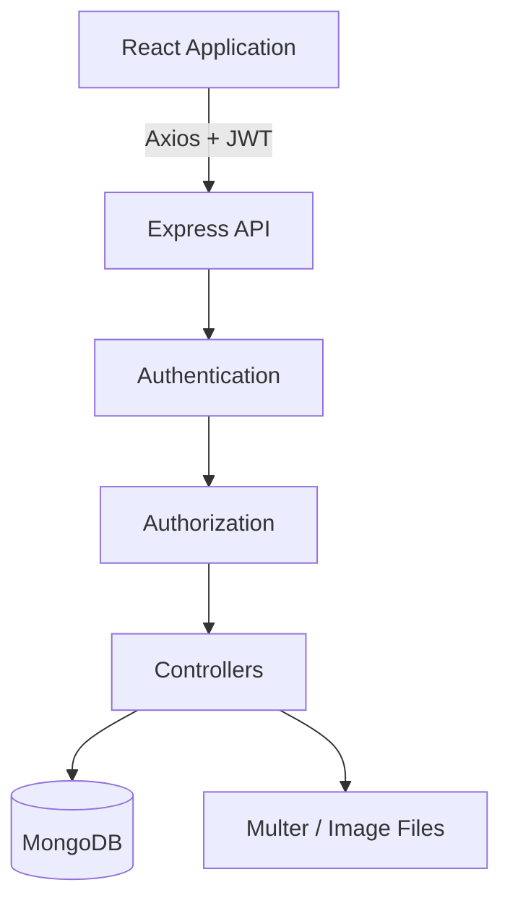

 # KaviosPix

**A full-stack photo management platform built around secure authentication, album-level authorization, and protected image delivery.**

[Live Application](https://frontend-five-puce-11.vercel.app/) | [Source Code](https://github.com/sunny-raj-sah/KaviosPix)


---

## Overview

KaviosPix lets users sign in with Google, create albums, upload images, organize them with tags, favorite and comment on photos, and share albums with other users.

The project goes beyond basic CRUD. Its core focus is how a full-stack application **authenticates users, controls access to private resources, and serves protected files**.

---

## The Problem

A photo application must answer more than "can a file be uploaded?"

- Who owns an album, and who has been granted access?
- Can a shared user perform owner-only actions?
- Can a private image be retrieved just by knowing its ID?
- Does the image belong to the album named in the request?

Each of these rules is enforced on the backend, not just hidden in the interface.

---

## Key Features

- **Google OAuth** sign-in with JWT-authenticated API requests
- **Album management**: create, update, delete, and organize
- **Image uploads** with server-side validation (JPEG, PNG, WebP, up to 5 MB)
- **Tags and filtering** through query parameters, such as ***?tags=travel,nature***
- **Favorites** page and **comments** on images
- **Album sharing** by email, with access revocation

---

## Architecture



| Layer | Details |
|---|---|
| Frontend | React, React Router, Context API, Axios service layer |
| Backend | Express with routes, controllers, middleware, centralized error handling |
| Data | MongoDB and Mongoose (Users, Albums, Images) |

---

## Security Design

### Authentication and authorization are separate concerns

| Layer | Question | Mechanism |
|---|---|---|
| Authentication | Who is making the request? | JWT verification, responds with ***401*** |
| Authorization | Can they access this resource? | Owner or shared-user check, responds with ***403*** |

A valid token proves identity. It does not grant access to every album.

 ### Reusable authorization middleware

*Owner-only actions:* ***authenticate*** → ***requireAlbumOwner*** → ***controller***

*Shared access:* ***authenticate*** → ***requireAlbumAccess*** → ***requireImageInAlbum*** → ***controller***

Access rules are centralized in middleware instead of repeated across controllers.
### Protected image retrieval

```http
GET /albums/:albumId/images/:imageId/file
```

Before any file is served, the backend verifies:

1. A valid JWT
2. Album access as owner or shared user
3. That the image belongs to the requested album

Uploads are never exposed as a public directory.

### Server-side upload validation

Multer enforces MIME type, file size, and generated filenames. Client-side validation improves usability, but the server is the security boundary.

---

## Challenges and Solutions

| Challenge | Solution |
|---|---|
| Coordinating the OAuth callback across Google, backend, and frontend | Find or create the user, issue a JWT, and sync frontend auth state |
| A valid JWT does not imply access to every album | Dedicated album-level authorization middleware |
| Private images retrievable by ID | Authenticated route with album and image relationship checks |
| Large, hard-to-maintain React pages | *Reusable components:* ***ImageGallery***, ***ImageCard***, ***ImageComments***, ***ImageFilter***, ***AlbumShareForm***, ***AlbumUploadForm*** |

---

## Key Learnings

- Authentication and authorization solve different problems, and both must be enforced by the backend.
- Hiding a button in the UI does not secure an endpoint.
- Debugging full-stack features means tracing the entire request lifecycle: state, API, JWT, middleware order, authorization, and file access.

---

## Planned Improvements

- Cloud object storage in place of local uploads
- Thumbnails, pagination, and lazy loading
- Search across images, albums, and tags
- Role-based sharing (Owner, Editor, Viewer)
- Unit, integration, and end-to-end testing
- Structured logging and monitoring

---

## Links

- **Live Application:** https://frontend-five-puce-11.vercel.app/
- **Source Code:** https://github.com/sunny-raj-sah/KaviosPix