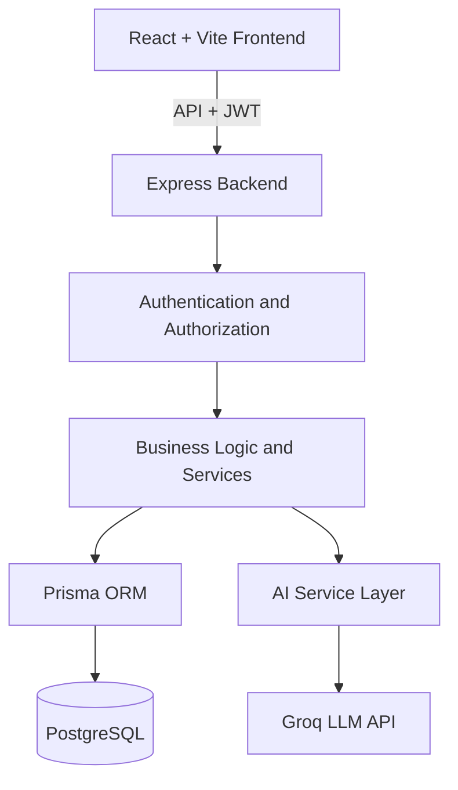

# GradeLens AI

**An education management platform that combines role-based academic workflows, performance analytics, and a role-aware AI assistant.**

[Live Application](https://grade-lens-ai-six.vercel.app/) | [Source Code](https://github.com/sunny-raj-sah/GradeLens-AI) | [Product Walkthrough](https://drive.google.com/file/d/1yQ1OGfDZWrqAw0yItCoePeJQoX586k38/view?usp=sharing)

---

## Overview

GradeLens AI centralizes classrooms, students, teachers, homework, submissions, and quiz results in one application. It serves three roles: **Admin**, **Teacher**, and **Student**.

An integrated AI assistant lets users ask natural-language questions about educational data. Access is determined by the user's role and classroom context.

The goal was not to build a standalone chatbot, but to **integrate AI into a real education management workflow**.

---

## The Problem

- Academic records are often spread across disconnected systems.
- Teachers and administrators lack a quick way to see who needs additional support.
- Finding information means navigating several screens and interpreting raw data by hand.
- Each role needs a different level of access. A student must never see another student's private information.

---

## Key Features

- **Role-based access** for Admin, Teacher, and Student, using JWT authentication and backend authorization
- **Classroom, student, and teacher management**
- **Homework and submission tracking**, kept as separate concerns
- **Quiz results and performance analytics** with a configurable support threshold (60) to flag students who may need help
- **Role-aware AI assistant** with a single shared backend entry point
- **Floating chat interface** available across the app, with chat state kept in browser storage
- **Classroom selector** with debounced search to avoid a request on every keystroke

---

## Architecture

| Layer | Details |
|---|---|
| Frontend | React, Vite, TypeScript, Bootstrap |
| Backend | Node.js, Express, TypeScript, service-layer structure |
| Database | PostgreSQL on Neon, managed with Prisma migrations |
| AI | Dedicated backend service integrated with the Groq LLM API |
| Deployment | Vercel |

---

## AI Integration Approach

The hard part of an AI feature is not generating an answer. It is **retrieving the right data for the right user before generating it**.

*AI request flow:*

***Authenticated request*** → ***Identify role*** → ***Determine classroom context*** → ***Retrieve permitted data*** → ***Prepare context*** → ***Groq LLM*** → ***Response***

Key decisions:

- **Backend-controlled context:** The backend decides which data is relevant. A classroom chosen in the frontend is never treated as authorization on its own.
- **One shared AI endpoint:** Role-aware processing replaces separate routes per role, which reduces duplication and keeps authorization boundaries consistent.
- **Dedicated AI service:** AI orchestration is isolated from routing and presentation, and reuses the existing classroom retrieval logic.
- **Role-appropriate context:** Admins get an institution-wide view, teachers work within a selected classroom, and students use general questions or their assigned classroom.

---

## Engineering Decisions

| Decision | Reason |
|---|---|
| TypeScript across the stack | Type checking, explicit data contracts, easier maintenance |
| PostgreSQL over JSON-based storage | Relationships, referential integrity, relational queries, migrations |
| Prisma ORM | Structured data access and easier schema evolution |
| Floating AI interface | AI becomes part of the workflow instead of a separate page |
| Debounced search | Fewer unnecessary API requests and a smoother interaction |

---

## Challenges and Solutions

- **Role-aware workflows:** Combined role-based UI behavior with backend authorization so access rules do not depend on the interface.
- **Integrating AI into an existing app:** Built a dedicated AI service that reuses classroom retrieval, since a generic chatbot has no knowledge of the academic structure.
- **Different context per role:** Used classroom selection for staff and assigned-classroom context for students, so scope comes from application rules instead of user input.
- **Evolving the data model:** Used Prisma migrations to add new relationships, such as the student–proctor assignment, without breaking existing data.

---

## Security Considerations

- Protected operations require