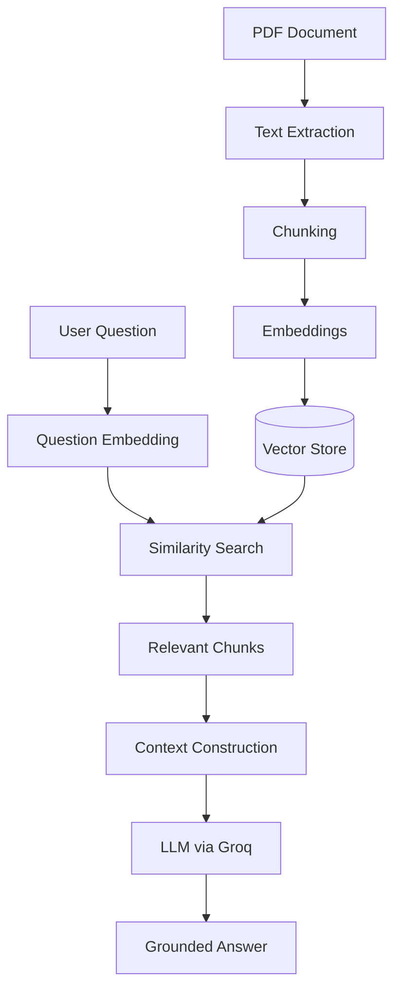

# Ask-The-Book

**A full-stack, Retrieval-Augmented Generation (RAG) application that answers questions about a 637-page technical PDF using retrieved document content instead of the model's general knowledge.**

[Live Application](https://ai-powered-rag-system-for-grounded.vercel.app/) | [Source Code](https://github.com/sunny-raj-sah/Ask-The-Book)

**Role:** Full Stack / AI Engineer | **Timeline:** June 2026 to July 2026

---

## Overview

Large language models write fluent answers, but they do not know the contents of a specific document. Ask-The-Book solves this by retrieving the relevant parts of a **637-page technical PDF** first, then asking the model to answer from that content.

The project combines a React frontend, a Node.js and Express backend, and a RAG pipeline into one application, not a standalone AI script.

---

## The Problem

Sending the entire document to an LLM with every question does not work well:

- Large documents can exceed model context limits.
- Re-sending the full text on every request is inefficient.
- The model may focus on irrelevant sections.
- Answers become less grounded in the source material.

*The core question:* ***How can a user ask natural-language questions about a large document while retrieving only the information relevant to that question?***

---

## How It Works

**Stage 1, ingestion:** The PDF is extracted, split into **1,600+ chunks**, converted into embeddings with Hugging Face models, and stored for search.

**Stage 2, question answering:** The question is embedded, compared with the stored chunks, and the closest matches are passed to the LLM as context to generate the answer.

Retrieval and generation are separate responsibilities, so each can be improved independently.

---

## Key Features

- **Semantic retrieval** that matches meaning, not just keywords
- **Retrieval-first answering**, so the model responds from supplied document context
- **Chunked processing** of a 637-page document into searchable units
- **React interface** with question input, loading states, error handling, and answer display
- **Layered backend** with routes, controllers, middleware, and services
- **Configurable model settings** kept in environment variables, not hardcoded

---

## Architecture

| Layer | Details |
|---|---|
| Frontend | React, with question input, loading and error states, and answer display |
| Backend | Node.js and Express, organized into routes, controllers, middleware, and services |
| RAG pipeline | LangChain, document processing, chunking, Hugging Face embeddings, retrieval, context construction |
| LLM provider | Groq |
| Deployment | Separate frontend and backend deployments, configured through environment variables |

*Backend separation:* ***Routes*** define endpoints, ***Controllers*** handle requests and responses, ***Middleware*** processes requests before controllers, and ***Services*** hold the RAG logic.

This keeps HTTP handling and AI logic loosely coupled, so the pipeline can evolve without rewriting the API layer.

---

## Engineering Decisions

| Decision | Reason |
|---|---|
| RAG over full-document prompting | Grounding, efficiency, and independent control over retrieval and generation |
| Embeddings over keyword search | Finds relevant content even when the wording differs from the question |
| Chunking with tuned size and overlap | Small enough to search well, large enough to keep useful context |
| Backend-held API credentials | Provider keys never reach the browser |
| Externalized model configuration | Models can be swapped without code changes |

---

## Challenges and Solutions

- **Processing a 637-page document:** Split it into chunks and embedded each one, so relevant sections are retrieved independently instead of loading the whole text.
- **Retrieval quality:** Used semantic embeddings, since a wrong retrieval produces a poor answer even from a strong model.
- **Model deprecation:** Several tested models became unavailable during development. The generation model, currently openai/gpt-oss-120b on Groq, is now configurable instead of assumed.
- **Grounded responses:** Followed a retrieval-first workflow so the model answers from supplied context, not from plausible-sounding guesses.

---

## Key Learnings

- An AI application is not just an LLM connected to a frontend. It is a **complete system around the model**: data, processing, retrieval, context, generation, and interface.
- Retrieval quality can matter as much as model quality. A stronger model cannot fully compensate for poor context.
- API credentials belong on the server, in environment variables, never in frontend code.
- Clear separation between frontend, API, and AI logic keeps the system maintainable.

---

## Planned Improvements

- Source and page citations in answers
- Measurable evaluation: Recall@K, Precision@K, answer groundedness, and latency
- Persistent vector storage and multi-document support
- Hybrid keyword and semantic search with reranking
- Streaming responses and conversation history
- Safer upload handling, rate limiting, and user-specific document isolation

---

## Links

- **Live Application:** https://ai-powered-rag-system-for-grounded.vercel.app/
- **Source Code:** https://github.com/sunny-raj-sah/Ask-The-Book