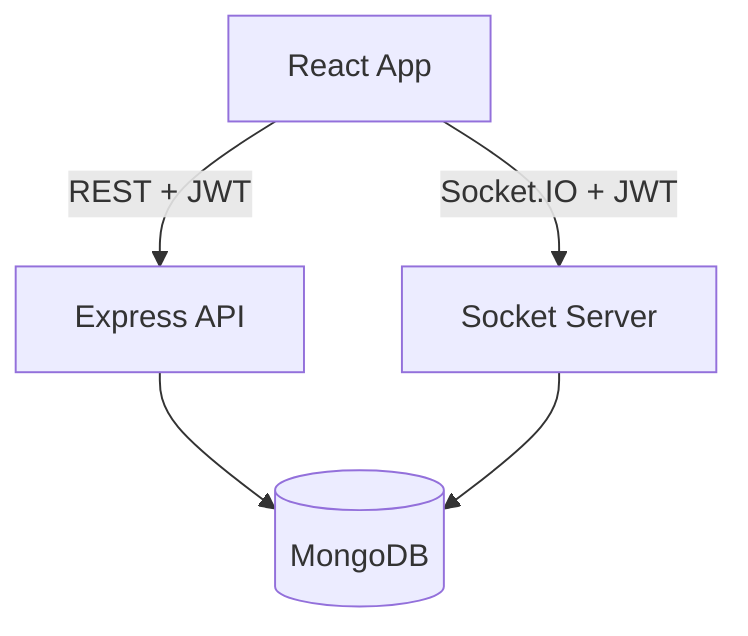

# Chat App

**A full-stack real-time messaging platform with JWT authentication, user discovery, live presence, typing indicators, and persistent conversations.**

[Live Application](https://chat-app-real-time-chat-application-woad.vercel.app/) | [Source Code](https://github.com/sunny-raj-sah/Chat-App)

---

## Overview

Chat App lets authenticated users search for other users, start conversations, and exchange messages in real time. It also shows online and offline presence and typing indicators, and lets users delete their own messages.

The project combines a **REST API** for persistent operations with **Socket.IO** for live events, so each tool handles the work it suits best.

---

## The Problem

Traditional REST applications make the client repeatedly ask the server whether anything has changed. For messaging, that means unnecessary requests and delayed updates.

The goal was a system where:

- Only authenticated users can access chat functionality.
- Messages and status changes appear without a page refresh.
- Messages are still persisted, so conversations survive a refresh or a new login.
- Users can only modify what they own, enforced by the server.

---

## Key Features

- **Authentication:** Registration, login, logout, and JWT-protected API routes
- **User discovery:** Search registered users and start a conversation
- **Real-time messaging:** Instant delivery, with messages stored in MongoDB and history loaded on return
- **Typing indicators** and **online/offline presence** with last-seen tracking
- **Message deletion** limited to the message owner, with live updates for the other participant
- **Conversation rooms** so events reach only the relevant participants

---

## Architecture

| Layer | Details |
|---|---|
| Frontend | React, Bootstrap, with AuthContext and ChatContext for shared state |
| Backend | Node.js and Express, organized into routes, controllers, middleware, services, models, and a socket module |
| Database | MongoDB with Users, Conversations, and Messages |
| Deployment | Frontend on Vercel, backend on Render |

*Division of responsibility:*

***REST API*** handles registration, login, user search, conversation retrieval, and message history.

***Socket.IO*** handles live messages, typing, presence, and deletion updates.

---

## Real-Time Design

*Message flow:*

***User sends message*** → ***Socket event*** → ***Server validates and identifies user*** → ***Persist to MongoDB*** → ***Emit to conversation room*** → ***Both participants update***

Key decisions:

- **Socket authentication:** The JWT is verified when a socket connects, so the server can tie every connection to a specific user.
- **Conversation rooms:** Messages are emitted to the room for one conversation instead of being broadcast to every connected user.
- **Temporary versus persistent data:** Typing state is a short-lived socket event and is never stored. Messages are persisted.
- **Presence lifecycle:** Socket connect and disconnect events update online status and last-seen information.

---

## Security Design

- **JWT authentication** protects API routes, and missing or invalid tokens return 401.
- **Server-side authorization** checks message ownership before a deletion is allowed. The frontend is never trusted to make that decision.
- **Protected conversations:** Users can only access conversations they take part in.
- **Password handling:** Passwords are never stored in plain text.
- **Input validation and CORS** restrict what the backend accepts and which frontend can call it.

---

## Challenges and Solutions

- **Synchronizing REST and real-time state:** Load history over REST, then merge incoming socket events into the same React state, which avoids duplicate, missing, or stale messages.
- **Socket listener lifecycle:** Clean up listeners when components unmount, since a listener registered more than once makes one message trigger several UI updates.
- **Scoped real-time events:** Use conversation rooms so events reach only the relevant participants.
- **Unauthorized deletion:** Verify ownership on the backend before removing or updating a message.

---

## Key Learnings

- WebSockets complement REST. Using each for what it does best keeps the architecture easier to reason about.
- Authentication has to extend to socket connections as well as HTTP routes.
- Real-time UIs need careful state synchronization and listener cleanup.
- Separating temporary real-time events from persistent data keeps the system simpler and cheaper to run.

---

## Planned Improvements

- Message pagination and database indexing for large conversations
- Refresh tokens with HTTP-only cookie authentication
- Group conversations, file and image sharing, and push notifications
- Redis adapter for scaling Socket.IO across multiple backend instances
- Rate limiting, centralized logging, and automated testing

---

## Links

- **Live Application:** https://chat-app-real-time-chat-application-woad.vercel.app/
- **Source Code:** https://github.com/sunny-raj-sah/Chat-App