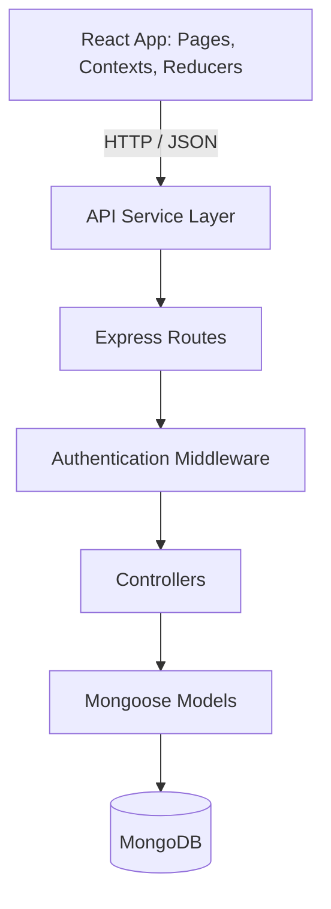

# Trendora Fashion

**A full-stack MERN e-commerce application with JWT authentication, product discovery, wishlist and cart workflows, address management, and an order backend.**

[Live Application](https://mern-shopping-site-43xo.vercel.app/) | [Source Code](https://github.com/sunny-raj-sah/Trendora-Fashion)

---

## Overview

Trendora simulates the core architecture of a modern shopping platform. Users can register, browse and filter products, save items to a wishlist, manage a cart and shipping addresses, and have their data stored per account.

The React frontend and the Node.js and Express backend are fully separated, with MongoDB as the primary database.

---

## The Problem

A shopping application is more than a product grid. It has to coordinate authentication, product discovery, search and filtering, user-specific data, and persistent storage, while keeping frontend state and backend resources clearly separated.

---

## Key Features

- **Authentication:** Registration and login with bcrypt password hashing and signed JWTs
- **Product discovery:** Listing, product details, category filter, text search, rating filter, and price sorting
- **Wishlist:** Add, remove, and retrieve saved products
- **Cart:** Add products, increase or decrease quantity, remove items, and avoid duplicate entries
- **Address management:** Full create, read, update, and delete for shipping addresses
- **Order backend:** A dedicated Order model with an authenticated API for creating orders and retrieving order history

*Example query:* ***GET /api/products?category=Clothing&search=shirt&rating=4&sort=lowToHigh***

---

## Architecture

| Layer | Details |
|---|---|
| Frontend | React, Vite, React Router, Bootstrap, React Toastify |
| State | Context API with reducers for auth, cart, wishlist, addresses, products, and orders |
| Backend | Node.js and Express, organized into routes, controllers, models, and middleware |
| Database | MongoDB with Mongoose (User, Product, Order) |

*API resources:* ***/api/auth***, ***/api/users***, ***/api/products***, ***/api/wishlist***, ***/api/cart***, ***/api/address***, ***/api/orders***

---

## Security Design

*Protected request flow:*

***Login*** → ***JWT generated*** → ***Token stored in browser*** → ***Bearer token on each request*** → ***Authentication middleware*** → ***User lookup*** → ***Protected controller***

- **Password hashing:** Passwords are hashed with bcrypt and never stored as plain text.
- **JWT verification on every request:** The middleware verifies the token, reads the user ID, loads the user, and attaches it to the request. Missing or invalid tokens are rejected.
- **User-scoped data:** Cart, wishlist, addresses, and orders belong to the authenticated user.
- **Environment configuration:** The database URI and JWT secret are loaded from environment variables.

---

## Engineering Decisions

| Decision | Reason |
|---|---|
| Embed cart, wishlist, and addresses in the User document | They belong to one user and are read together, so retrieval and updates stay simple |
| Separate Product and Order collections | Products are shared resources, and orders are historical transaction records |
| Store item price inside each order | The order keeps the price paid, even if the product price changes later |
| Context API with reducers | Predictable state transitions without adding Redux |
| Reusable API request layer | Base URL, JSON handling, authorization headers, and errors are written once |

---

## Challenges and Solutions

- **Authentication boundaries:** Coordinated the login UI, token storage, and protected API. A token alone is not enough, so the backend validates it on every protected request.
- **User-specific MongoDB data:** Embedded the cart, wishlist, and addresses in the user document, which simplified the model while keeping authenticated CRUD operations.
- **Frontend and backend responsibility:** Kept persistent resources on the backend and interface state on the frontend, with a shared API layer between them.
- **Duplicate cart entries:** Adding a product that is already in the cart increases its quantity instead of creating a second entry.

---

## Key Learnings

- Authentication needs coordination across the UI, token storage, and server-side verification.
- Choosing what to embed and what to store in its own collection is a core data modeling decision.
- Building a backend capability and integrating it into the frontend are separate pieces of work, and both must be finished before a feature is truly complete.
- Context and reducers give clear state management at this scale without extra libraries.

---

## Planned Improvements

- Connect the checkout flow to the existing order API so orders persist in MongoDB and appear in order history
- Payment gateway integration and verification
- Product pagination, an admin dashboard, and inventory management
- Refresh tokens, request validation, rate limiting, and strict CORS allowlisting
- Automated testing and cloud image storage

---

## Links

- **Live Application:** https://mern-shopping-site-43xo.vercel.app/
- **Source Code:** https://github.com/sunny-raj-sah/Trendora-Fashion