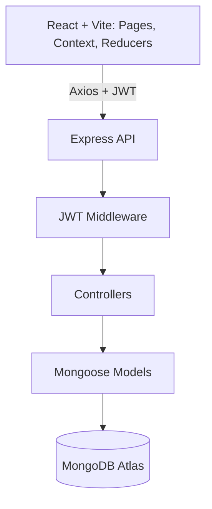

# Workasana

**A full-stack task management application with JWT authentication, related project, team, and task data, server-side filtering, and visual reports.**

[Live Application](https://workasana-task-management-applicati-phi.vercel.app/) | [Source Code](https://github.com/sunny-raj-sah/Workasana)

---

## Overview

Workasana is a centralized workspace for organizing projects, tasks, teams, users, and tags, and for tracking progress. A React application talks to a secured REST API, and all data is stored in MongoDB through Mongoose.

---

## The Problem

When projects, owners, teams, deadlines, and task statuses are spread across different places, it is hard to see what is happening. Workasana brings them into one structured workflow: create projects, assign owners, link tasks to teams, track status, filter work, and review progress.

---

## Key Features

- **Authentication:** Signup and login with bcrypt password hashing and JWTs that expire after seven days
- **Task management:** Full create, read, update, status change, and delete, with statuses To Do, In Progress, Completed, and Blocked
- **Projects, teams, users, and tags:** Each has its own REST API and model
- **Server-side filtering** by project, team, status, and owner
- **Dashboard and reports:** Task and project overview, with Chart.js charts
- **Profile settings:** Update profile and change password
- **Seed script** that loads sample teams, users, tags, projects, and tasks for local development

*Example query:* ***GET /api/tasks?project=projectId&status=In Progress***

---

## Architecture

| Layer | Details |
|---|---|
| Frontend | React, Vite, React Router, Bootstrap, React-Bootstrap, Chart.js |
| State | Context API with useReducer |
| Backend | Node.js and Express, organized into routes, controllers, models, middleware, and config |
| Database | MongoDB Atlas with Mongoose |
| Deployment | Frontend on Vercel |

*Task relationships:* ***Task*** references ***Project***, ***Team***, and ***Owners*** by ObjectId, and stores ***Tags*** as strings.

---

## Authentication and Security

*Request flow:*

***Login*** → ***JWT generated*** → ***Stored in browser*** → ***Axios interceptor adds Bearer token*** → ***Auth middleware verifies*** → ***Controller***

- **Protection on both sides:** React protected routes guard the pages, and JWT middleware guards the project, task, team, user, and tag APIs. The frontend check alone is never trusted.
- **Session restore:** On startup, the app checks for a saved token and calls the current-user endpoint. If the call fails, the token is removed and the user is logged out.
- **Password hashing:** bcrypt hashes passwords on signup and compares them on login.
- **Environment secrets:** The JWT secret and database URI are loaded from environment variables.

---

## Engineering Decisions

| Decision | Reason |
|---|---|
| Context API with useReducer | Predictable state transitions for auth and shared data without adding Redux |
| Centralized Axios instance with interceptor | The Authorization header is written once instead of on every API call |
| Mongoose populate for references | Responses include project, team, and owner details, so the UI needs no extra requests |
| Server-side query filtering | The database applies filters instead of the browser downloading everything |
| Resource-based routes and controllers | Each resource has its own route, controller, and model, which keeps the backend modular |

---

## Challenges and Solutions

- **Authentication state across the app:** Combined localStorage, AuthContext, useReducer, and a current-user check, so the session survives a refresh and is still verified by the server.
- **Related data in tasks:** Tasks depend on projects, teams, and owners. Mongoose populate returns the related details in one response.
- **Filtering design:** Built a dynamic MongoDB filter from query parameters, which leaves room to handle larger datasets later.
- **Shared state across pages:** Used Context API and reducers instead of passing props through deeply nested components.

---

## Key Learnings

- A request travels through many layers, from the React component to Axios, Express, middleware, Mongoose, and MongoDB, and back to the UI. Understanding the whole path makes debugging much faster.
- Protecting routes on both the client and the server is what makes access control real.
- Referenced documents and population keep data normalized while still giving the frontend what it needs.

---

## Planned Improvements

- Role-based access control and resource-level authorization
- HTTP-only cookie authentication with refresh tokens, replacing localStorage
- Pagination, database indexes, and advanced search
- Request validation and centralized error handling
- Real-time task updates, comments, attachments, and notifications
- Automated testing and API documentation with Swagger

---

## Links

- **Live Application:** https://workasana-task-management-applicati-phi.vercel.app/
- **Source Code:** https://github.com/sunny-raj-sah/Workasana